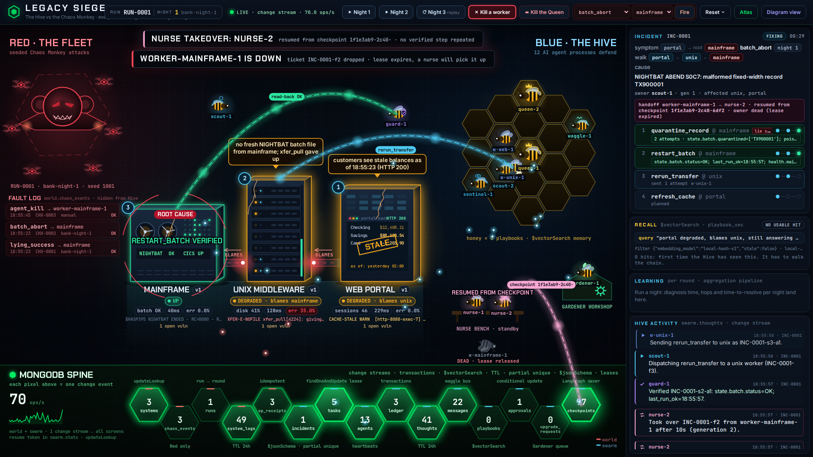
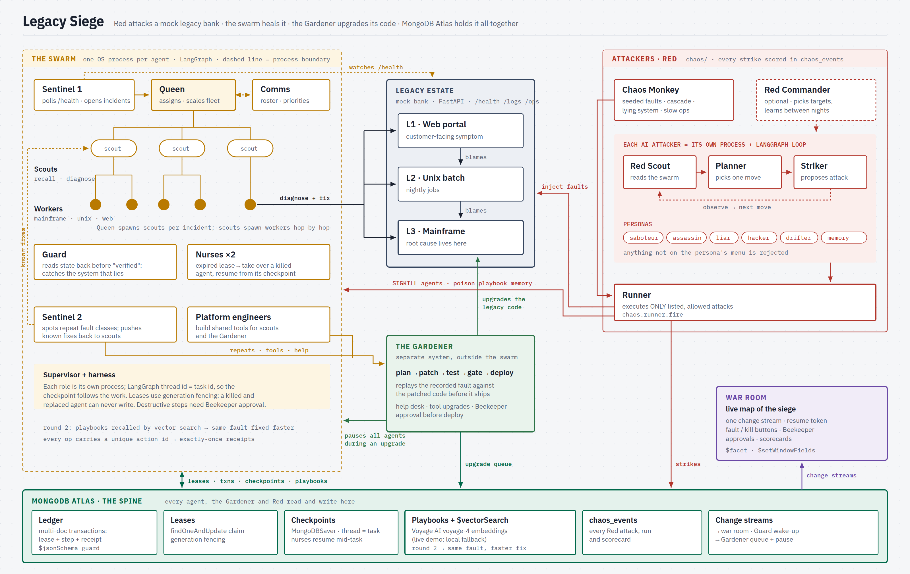
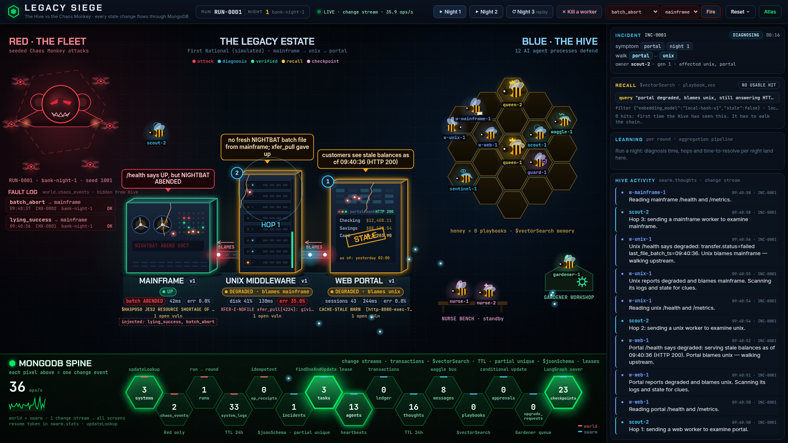
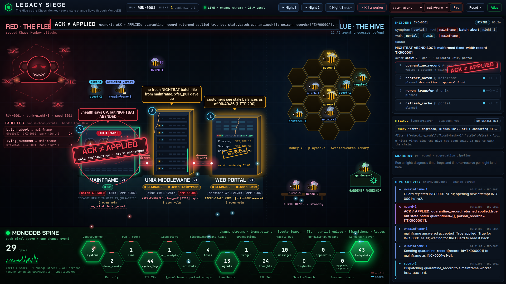
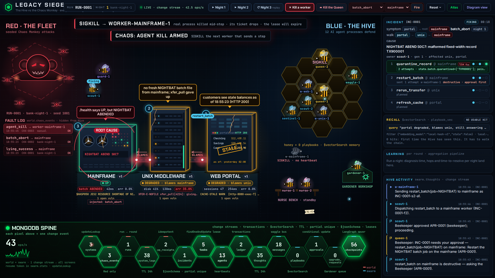
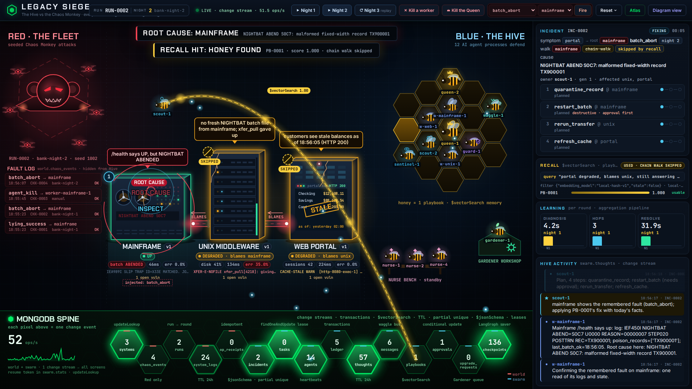

# Legacy Siege

A team of AI agents keeps a simulated bank's legacy estate running (a mainframe batch, a Unix file-transfer
box and a customer web portal) while a Chaos Monkey attacks the systems *and the agents themselves*. Agents get
`SIGKILL`ed mid-fix, systems lie about whether an operation worked, and fields get renamed underneath the team.
The agents have to finish the job anyway.

Every piece of state lives in MongoDB. Every process is disposable.



<sub>The war room, Night 1. Red has aborted the mainframe batch; the portal still answers HTTP 200 with stale
balances. `worker-mainframe-1` was killed mid-step, and `nurse-2` has picked up its ticket from the LangGraph
checkpoint in MongoDB without repeating the step that was already verified.</sub>

Design doc: https://claude.ai/artifact/TYfnA6aTSG99oMb9t1nzpr (also in [`docs/design-doc.pdf`](docs/design-doc.pdf))

## Why we built this

Banks still run core business on decades-old, tightly coupled systems. When the nightly batch on the mainframe
breaks, the customer portal three hops away goes wrong, and it usually doesn't go *down*: it keeps serving
yesterday's balances with a 200. The people who know how to trace that are retiring.

We built this for a MongoDB hackathon, Problem Statement 3, "Finish the Job": long, multi-step work where an
agent has to know whether an action actually took effect, resume after a crash without replaying what's done,
and cope when the systems change while it's working. Most agent demos assume the world is honest and the agent
stays alive. Here neither is true, on purpose:

- **The systems lie.** An op can return `applied: true` and do nothing, or apply 20 seconds after it said
  "accepted". The only thing allowed to mark a step verified is a read-back of real state.
- **The agents die.** Chaos sends a real `SIGKILL` to agent processes. Work is held under leases, not owned,
  and a nurse resumes it from a checkpoint in MongoDB.
- **The ground moves.** A vendor patch renames a field. The Gardener ships code upgrades. The agents have to
  notice and adapt rather than keep running yesterday's fix.

## How it works



Four parts, and they only talk to each other through the systems' HTTP API and MongoDB:

| part | code | what it is |
|---|---|---|
| **The legacy estate** | `systems/` | One FastAPI app with three mock systems: mainframe → unix → portal. Each has `/health` (with the dependency it blames), `/logs`, `/state` and `/ops`, a 1 s tick, planted vulnerabilities, and two honesty faults (lying ops, late ops). State is in the `world` DB. |
| **Red, the Fleet** | `chaos/` | A seeded Chaos Monkey. Scenarios `bank-night-1/2/3` replay identically every time. It fires faults at the systems and kills agents. Optional AI attackers sit on top (see [Optional modes](#optional-modes)). Every strike goes through one allow-list, `chaos.runner.fire`. |
| **Blue, the Hive** | `swarm/` | 12 agent *processes* (not threads, so a kill is a real crash): queen ×2, scout ×2, a worker each for mainframe / unix / web, guard, waggle, sentinel, nurse ×2. Each role is a LangGraph graph checkpointed into MongoDB. |
| **The Gardener** | `gardener/` | A separate system outside the swarm. When the same fault keeps coming back, it writes a patch for the legacy code, runs the tests plus a replay of the fault, asks the human (the "Beekeeper") to approve, hot-deploys it and then proves it by replaying the attack. |

And one more that isn't really a part: **the war room** (`warroom/`) is a live view that only *watches*
MongoDB through a change stream. It holds no state of its own; every pixel on screen comes from a change event.

### An incident, start to finish

1. **Detect.** The sentinel polls `/health` and opens an incident. If three systems are failing for the same
   reason it opens *one* incident, not three (a partial unique index on the correlation key does the coalescing).
2. **Claim.** A scout takes the incident with a lease: one atomic `findOneAndUpdate` that bumps a generation
   number.
3. **Recall.** The scout runs `$vectorSearch` over past playbooks. On a hit above 0.70 it skips straight to the
   known root cause.
4. **Diagnose.** Otherwise it walks the chain hop by hop, following each system's `blames` field:
   portal → unix → mainframe.
5. **Plan and approve.** Destructive steps (like `restart_batch`) wait for the Beekeeper's approval *before*
   anything is sent.
6. **Act.** Workers send each step with a unique action id. The step change and its ledger receipt are written in
   one transaction, so the timeline and the audit log can't disagree. A retried op hits a duplicate key and
   gets the stored receipt instead of running twice.
7. **Verify.** Only `guard-1` can mark a step verified, and only with read-back evidence. If the system said
   `applied: true` but the state didn't change, the guard stamps it **ACK ≠ APPLIED** and opens a new attempt.
8. **Resolve and learn.** The incident closes and a playbook is saved with an embedding, in the same
   transaction. When a fault class has been resolved twice, the sentinel files an upgrade request for the
   Gardener.

If an agent dies anywhere in there, its heartbeat stops, the Undertaker marks it dead, its lease expires, and a
nurse takes the task over at generation + 1. The dead agent can't write any more even if it comes back, because
every write is conditional on `{owner, generation}`. The nurse loads the LangGraph checkpoint (the thread id is
the *task* id, so the checkpoint follows the work, not the process), reconciles anything stuck in `sent` against
the real system, and carries on.

### The demo, in four beats

| | |
|---|---|
|  **Cascade.** The portal blames unix, unix blames the mainframe, and the mainframe's own `/health` says "up". The scout walks the chain to a batch job that ABENDed on a malformed record. |  **The lie.** `quarantine_record` returns `applied: true` and does nothing. The guard reads the state back, catches it, and attempt a2 goes green with evidence. |
|  **The kill.** A real `SIGKILL` while a worker has a step in flight. A nurse takes the lease and resumes from the checkpoint; the op hits the estate once. |  **Round two.** Same attack, next night. `$vectorSearch` recalls the playbook and the scout fixes it in 1 hop instead of 3. |

Then the Gardener turns the repeated batch abort into a real patch to `systems/mainframe.py` (validate the
fixed-width record before the batch runs), the mainframe goes v1 → v2, the old playbooks are marked stale, and on
Night 3 the identical attack is shrugged off: no incident opens at all.

All of that is checked from MongoDB by `scripts/demo_check.py` (26 checks; see [Rehearse](#rehearse)).

### Statement 3, question by question

| question | what we built | where |
|---|---|---|
| Took effect, or only sent? | Unique action id per op, written in one transaction with the incident step; only the Guard's read-back can mark a step verified (ACK ≠ APPLIED) | `swarm/steps.py` `attempt_id()`, `mark_sent()`, `record_response()` · `swarm/verify.py` `check()` · `common/db.py` `txn()` |
| Resume after a crash without replaying? | Leases claimed with one atomic findOneAndUpdate plus a generation fence; a Nurse takes over an expired lease; LangGraph checkpoints in MongoDBSaver (thread id = task id) | `swarm/leases.py` `claim()`, `takeover()`, `fence()` · `swarm/steps.py` `take_over_sent()` · `swarm/harness.py` `checkpointer()` |
| Adapt when fields or workflow change? | `$jsonSchema` check + field diff spots a renamed field; the mapping is verified against real values and stored per system version; workflow drift is checked too | `swarm/schema.py` `json_schema()`, `conforms()`, `mapping()` · `swarm/workflow.py` `check()`, `propose()` |
| Past experience (Vector Search) | Fixes saved as playbooks, recalled with Atlas `$vectorSearch` over Voyage AI embeddings, filtered by model, stale ones skipped; poisoned memories rejected | `swarm/recall.py` `search()`, `build_playbook()` · `common/embed.py` `embed()` · `swarm/recovery.py` `reject_bad_memory()` |
| Systems that won't hold still | Red Strikers attack live, but every strike goes through one allow-list; the Gardener turns repeat faults into code upgrades proven by replay | `chaos/runner.py` `fire()` · `chaos/redfleet/` · `gardener/pipeline.py` · `gardener/replay.py` |
| Knowing what actually happened | Tamper-evident hash chain of every ownership change, built from change-stream pre-images (behind the `MONGO_SPINE` switch) | `swarm/custody.py` `append()`, `verify_chain()` |

### What MongoDB is doing

MongoDB isn't the place we park data at the end. It's how the agents coordinate.

| feature | what it does here | where |
|---|---|---|
| Multi-document transactions | Each step transition fences the lease, updates the incident step and upserts the ledger receipt together. Also: resolve + playbook insert, every estate tick/op/chaos hook, the Gardener's approval and deploy records | `swarm/steps.py` · `swarm/roles/scout.py` `resolve` · `systems/estate.py` `_txn()` · `gardener/pipeline.py` `request_approval()`, `deploy()` |
| `findOneAndUpdate` leases with generation fencing | Claim with `$inc generation`; renewals and writes are conditional on `{owner, generation}`, so a killed-and-replaced agent can't write | `swarm/leases.py` `claim()`, `takeover()`, `renew()`, `fence()` |
| Exactly-once ops | `op_receipts._id = action_id`; a retry hits a duplicate key and gets the stored receipt | `systems/estate.py` `op()` |
| Partial unique index | One *active* incident per `correlation_key`; a second insert merges with `$addToSet` instead | `scripts/setup_db.py` · `swarm/roles/sentinel.py` `open_or_grow` |
| `$jsonSchema` validation | Rejects unknown step statuses and any `verified` step without evidence | `scripts/setup_db.py` |
| Atlas Vector Search | Playbook recall by symptom text, pre-filtered on `{embedding_model, stale: false}`; the query, filter, hits and scores are stored on the incident | `swarm/recall.py` `search()`; index `playbook_vec` in `scripts/setup_db.py` |
| Change streams | The war room (one cluster-level stream, `updateLookup`, persisted resume token), guard wake-up, the waggle bus, the Gardener's queue and approval wait, and its prove window | `warroom/stream.py` · `swarm/roles/guard.py` · `swarm/roles/waggle.py` · `gardener/main.py` · `gardener/pipeline.py` |
| Aggregation pipelines | Orphaned work for nurses (`$lookup`), recurring faults for the sentinel (`$group` + `$lookup`), sent steps for the guard (`$unwind`), the scorecards, Gardener evidence | `swarm/roles/nurse.py` `_orphans()` · `swarm/roles/sentinel.py` · `warroom/api.py` `scorecard_pipeline()` · `chaos/score.py` · `gardener/pipeline.py` `evidence_summary()` |
| TTL indexes | Logs, thoughts and messages expire after 24 h | `scripts/setup_db.py` |
| LangGraph `MongoDBSaver` | Every role is a StateGraph checkpointed in `swarm.checkpoints`, keyed by task id | `swarm/harness.py` `checkpointer()` · `swarm/roles/nurse.py` `load_checkpoint` |
| Atomic counters | `INC-0001`, `RUN-0001`, `CHX-0001` | `common/db.py` `next_id()` |
| Conditional update | A Beekeeper decision only lands on `{status: "pending"}`, so double clicks are no-ops | `warroom/api.py` `decide()` |
| Change-stream pre-images (`MONGO_SPINE=1`) | Every claim, takeover, release and approval becomes a sha256-chained `swarm.custody` row | `swarm/custody.py` · `scripts/setup_db.py` `ensure_spine()` |
| `$facet` + `$setWindowFields` + `$percentile` (`MONGO_SPINE=1`) | Learning curve per fault class, p50/p90 time-to-resolve per round, median takeover time, all computed in MongoDB | `warroom/spine.py` |

### More diagrams

- [Full-system architecture](docs/diagrams/architecture.png) ([SVG](docs/diagrams/architecture.svg))
- [Whiteboard view](docs/diagrams/architecture-whiteboard.png): the team's whiteboard sketch, made accurate ([SVG](docs/diagrams/architecture-whiteboard.svg))
- [The Gardener outside the swarm](docs/diagrams/gardener-outside.png)
- [Mermaid version](docs/diagrams/architecture-mermaid.md) (GitHub renders it inline)
- [All of them, with notes](docs/diagrams/README.md); the main diagram's source is [`architecture-v3.html`](docs/diagrams/architecture-v3.html)

## Running it

You need Python 3.12 and a MongoDB that supports transactions, change streams and Vector Search. Locally that's
the Atlas Local image; any Atlas tier works too, including the free M0.

```bash
uv venv .venv && uv pip install -r deploy/requirements.txt
docker run -d --name legacy-siege-mongo -p 27027:27017 mongodb/mongodb-atlas-local:8.0
cp .env.example .env    # optional: keys go here, nothing is required

.venv/bin/python run.py --reset
```

`run.py` creates the collections, validators and indexes (including the vector index), then starts four
processes: the systems on `:8701`, the war room on `:8700`, the swarm supervisor (which starts the 12 agents)
and the Gardener. If one crashes it gets restarted, since all the state is in MongoDB anyway. Logs go to
`logs/*.log`. Open http://localhost:8700. Stop it with Ctrl-C.

`PACE=0.3 .venv/bin/python run.py --reset` runs the deliberate "thinking" pauses about 3× faster, which is what
you want while rehearsing.

Prefer Docker for the whole thing? `docker compose -f deploy/docker-compose.yml up --build -d` brings up the app
and its own MongoDB. It has to stay **one container, one instance**: chaos kills agents by PID, so they must
share a PID namespace. [`deploy/README.md`](deploy/README.md) covers Atlas, a plain VM and Fly.io.

### Point it at Atlas

Put the connection string in `.env` as `MONGODB_URI` (the app reads nothing else) and allow your IP in Atlas
Network Access. To check a cluster supports everything we use (transactions, change streams, TTL, partial unique
indexes, `$jsonSchema`, a vector index round-trip) on a throwaway DB:

```bash
.venv/bin/python -m scripts.atlas_check
```

### Keys (all optional)

The whole demo runs with no keys. The policy that decides which op runs is deterministic; models add to it, they
don't replace it.

| variable | what it turns on | without it |
|---|---|---|
| `ANTHROPIC_API_KEY` (+ `LLM_MODEL`) | Agents and the Gardener write their own explanations. Needed for `AI_SECOND_OPINION` and `AI_DRIVES` | Fixed sentences and a template explanation |
| `AI_SECOND_OPINION=1` (+ key) | Claude's independent diagnosis and op plan per incident, judged op by op by the policy and the read-backs. Overruled ops show the rule that stopped them | No AI card |
| `AI_DRIVES=1` (+ key) | Claude reasons over the evidence at plan time and its plan runs if it passes every guardrail; otherwise (or after `AI_DRIVE_TIMEOUT_S`, 6 s) the rules plan runs and the card says why | Rules plan |
| `VOYAGE_API_KEY` (+ `VOYAGE_MODEL`, default `voyage-4`) | Voyage AI embeddings for playbook recall | A deterministic local hashing model (`local-hash-v1`, 1024-d); same vector index |
| `MONGO_SPINE=1` | Change-stream pre-images, the custody chain, four more validators, the spine analytics card. Needs MongoDB 7.0+; run `scripts.setup_db` once with it on | Off |
| `PACE` (default 1.0) | Multiplier on the deliberate pauses (0 in tests) | |

### Driving the demo

The war room has views at `/` (classic), `/diagram` (the stage view: click or 1–4 to zoom, V toggles Live / How
it works), `/flow`, and `/why` (use cases and Statement 3 point by point). `WARROOM_VIEW=diagram|flow|classic`
picks what `/` serves.

| click | what you see | the MongoDB side |
|---|---|---|
| **Reset ▸ Full** | Everything green, the hive idle | `setup_db.reset`, Gardener revert, roster restored |
| **▶ Night 1** | Lightning on the mainframe, the batch ABENDs, unix then portal go amber; the portal shows STALE while still serving 200 | `chaos_events` insert → `world.systems` updates stream in |
| (watch) | One coalesced incident card; a blue pulse walks portal → unix → mainframe | Partial unique index, `tasks` leases, `diagnosis_path` |
| (watch) | **ACK ≠ APPLIED** on `quarantine_record`; attempt a2 goes green | `op_receipts.lied`, ledger a1 failed / a2 verified |
| **Approve** | `restart_batch` waits for you *before* anything is sent | `approvals` pending → approved |
| **✕ Kill a worker** (glows when a worker is mid-step) | The worker falls; a nurse picks up its ticket, "resumed from checkpoint …" | Real SIGKILL, lease `generation+1`, checkpoint loaded |
| (watch) | All green; a honey cell fills | Resolve + playbook insert in one transaction |
| **Reset ▸ Next round**, **▶ Night 2** | "Recall hit … skipping the chain walk": 1 hop instead of 3, and the learning chart | `$vectorSearch` with stored query, filter and score |
| **Approve** twice (restart, then the upgrade) | The Gardener's diff, tests ✓, replay ✓; mainframe v1 → v2, old honey greys out | `upgrade_requests` state machine, stale playbooks |
| **↻ Night 3** | The same attack, and nothing happens | `prove.incident_opened: false` |
| **Atlas** | Every collection with its indexes, validators and a real document | `GET /api/atlas`, `GET /api/doc/...` |

The fault launcher (top right) fires any single fault by hand: `lying_success`, `slow_apply`, `disk_fill`,
`cron_stop`, `session_leak`, the exploits `sqli_exploit` / `config_exploit`, and `schema_drift`. From the
command line: `python -m chaos.cli list`, `python -m chaos.cli run bank-night-1`, `python -m chaos.cli fire <fault>`.

**Schema drift** is the "layout changed underneath us" beat. A vendor patch renames the unix manifest's `balance`
field to `acct_bal`. Unix stays green, but the portal can't read balances any more. The hive diffs the new
sample against a known-good one (`$jsonSchema` + a field-diff aggregation), proposes `balance → acct_bal`, and
the guard verifies it by read-back. The mapping is stored in `swarm.schema_mappings` per version, so when the
same rename comes back on a later night the hive says "seen before: mapping v2 reused" with no model call. With a
key and `AI_SECOND_OPINION=1` Claude proposes the mapping (renaming is a question of meaning); without one, a type
+ value match does it. Scenario `bank-drift` plays it, and `python -m scripts.drift_check` rehearses it.

<details>
<summary><b>Stage settings and measured timings</b></summary>

Every knob below defaults to the old behaviour. For a judged run, put these in `.env`:

```
PACE=0.1                 # deliberate "thinking" pauses (latency already paces the screen)
STEP_HOLD_S=0.6          # keep the agent-kill window open even with a tiny PACE
PROVE_WINDOW_S=12        # Gardener prove window (default 30; unpatched code opens an incident in ~6-15 s)
NIGHT3_WATCH_S=12        # demo_check's night-3 watch (default 25)
DEAD_AFTER_S=7           # Undertaker: >2 missed heartbeats (HEARTBEAT_S=3); task leases stay LEASE_S=10
SYSTEMS_TICK_FIXED=1     # 1 s tick on a fixed cadence (default sleeps 1 s AFTER a ~2 s remote tick)
CASCADE_TICKS=2          # staleness spreads one hop per 2 ticks instead of 3
DEMO_AUTOPLAY=1          # 3 clicks: Night 1, the first Approve, Kill
```

**Autoplay** (`DEMO_AUTOPLAY=1`): Night 2 starts by itself `AUTOPLAY_GAP_S` (4 s) after Night 1 is green, and
Night 3 after Night 2 is green *and* the upgrade is proven. The first approval stays a manual click; later ones
auto-approve after `AUTOPLAY_APPROVE_S` (3 s) with a visible "auto-approved (same as last time)" line
(`decided_by: autoplay`). The kill stays a manual press. `demo_check` follows along when `DEMO_AUTOPLAY=1` is
set (or with `--autoplay`).

Measured with `scripts.demo_check` (26/26 every run), Night 1 click to the end of Night 3. RTT is the MongoDB
round trip, emulated with a TCP delay proxy in front of local MongoDB:

| settings | RTT | Night 1 | Night 2 | Gardener | Night 3 | total |
|---|---|---|---|---|---|---|
| defaults, PACE 0.6 | 0 ms | 49.6 s | 27.1 s | 40 s | 25 s | ~143 s |
| demo pace (PACE 0.3, prove 12, watch 12) | 0 ms | 35.7 s | 20.2 s | 22 s | 12 s | ~95 s |
| demo pace + autoplay | 0 ms | 35.9 s | 22.2 s | 22 s | 12 s | ~100 s |
| demo pace (PACE 0.3) | 94 ms | 106.5 s | 73.4 s | 28 s | 13 s | ~233 s |
| full stage block above | 94 ms | 103.7 s | 70.7 s | 40 s | 14 s | ~243 s |
| full stage block above | 20 ms | 38.7 s | 24.5 s | 22 s | 12 s | **~108 s** |
| Atlas Sandbox, defaults, PACE 0.6 | ~90 ms | 119 s | 69 s | | | 305 s whole check |

At ~90 ms RTT the run is bound by round trips, not pauses: each swarm step is roughly 20–30 of them (checkpoints,
transactions, leases). If you need it under 3 minutes, run the stack in the same region as the cluster.

</details>

### Rehearse

With the stack running:

```bash
.venv/bin/python -m scripts.demo_check            # full reset → nights 1-3 + Gardener → full reset
.venv/bin/python -m scripts.demo_check --keep     # leave the upgraded estate on screen at the end
```

It drives the same API the buttons use, approves after `--approve-delay` seconds (default 1.5), kills a worker in
`step_sent` right after `restart_batch` is approved, and then asserts every beat straight from MongoDB:

- **a.** The cascade: portal blames unix, unix blames mainframe, mainframe up but the batch ABENDed; one coalesced
  incident; diagnosis `portal→unix→mainframe`, root `mainframe`, class `batch_abort`.
- **b.** A guard `reject` thought; attempt a1 is `applied: true` with ledger status failed; the final attempt is
  verified with evidence; ledger and incident steps stay in sync with unique action ids.
- **c.** The approval was created and decided before the op's ledger receipt, which records `approver: beekeeper`.
- **d.** The killed process is really gone; the Undertaker marks it dead within `LEASE_S + 2·HEARTBEAT_S`; a nurse
  owns the task at generation 2 from a checkpoint that exists in `swarm.checkpoints`; verified steps aren't re-sent
  and the killed op hit the estate once; a standby nurse is respawned.
- **e.** The incident resolves, all systems are up, and a playbook is saved with a 1024-d embedding,
  `embedding_model` and `system_version`.
- **f.** Night 2: `recall.used` with score ≥ 0.70, path `[mainframe]`, fewer hops, lower `diagnosis_s`.
- **g.** The upgrade is filed, tested (pytest + replay), approved, `mainframe.py` patched to v2, v1 playbooks
  stale, upgrade `proven`, Night 3 opens no incident, and the final reset restores the legacy `mainframe.py`.

It prints a PASS/FAIL table with timings and exits non-zero on any failure. This script is the line we don't
cross: if it isn't all-pass, the change doesn't go in.

### Tests

Each workstream has its own suite on isolated databases (`world_test_*` / `swarm_test_*`). Run them against
local MongoDB, not Atlas:

```bash
export MONGODB_URI='mongodb://localhost:27027/?directConnection=true'
PACE=0 .venv/bin/python -m pytest systems/tests chaos/tests gardener/tests warroom/tests -q
PACE=0 .venv/bin/python -m pytest swarm/tests -q        # real agent processes, ~90 s
```

## Optional modes

All off by default. With none of these set, the seeded nights play exactly as described above. Keep the Red ones
off for `scripts.demo_check`, since it times the seeded beats.

<details>
<summary><b>Red fleet: AI attackers</b> (<code>RED_FLEET=1</code>)</summary>

`run.py` also starts `python -m chaos.redfleet`: AI attackers that play on top of the seeded nights. Each is its
own process running its own LangGraph loop (scout → plan → strike → observe):

| attacker | strikes with | Statement 3 angle |
|---|---|---|
| `red-saboteur` | `batch_abort`, `disk_fill`, `cron_stop`, `session_leak`, timed to break whatever the hive is about to fix next | systems won't hold still mid-job |
| `red-assassin` | `agent_kill`: the worker mid-send, the crowned queen, a scout, the guard, the sentinel | resume after a crash |
| `red-liar` | `lying_success`, `slow_apply`, `false_log` (planted log lines blaming the wrong system) | took effect vs only sent |
| `red-hacker` | `credential_exploit`, `sqli_exploit`, `config_exploit` while the vuln is still open | an intruder mid-job |
| `red-drifter` | `schema_drift` | adapt when fields change |

Each attacker reads the hive's state from MongoDB (open incidents, pending steps, live agents, learned
playbooks, what the rest of the fleet already did). Claude picks *one* item from that attacker's menu, which is
built from the existing fault library. An off-menu pick is rejected and the attacker's deterministic playbook
decides instead, which is also what runs with no key, on a timeout or on bad JSON. Every strike goes through
`chaos.runner.fire`, so it's an ordinary `chaos_events` document signed `by: "red-<name>"`.

No caps by default. `RED_FLEET_COOLDOWN_S` (30 s per attacker) keeps the war room readable;
`RED_FLEET_MAX_ATTACKS`, `RED_FLEET_FIRST_STRIKE_S`, `RED_FLEET_SKIP_SCENARIOS`, `RED_FLEET_FAULTS`,
`RED_FLEET_AGENTS` and `RED_FLEET_LLM=0` tune it. Guardrails that always stay on: it refuses the live
`world`/`swarm` DBs unless `RED_FLEET_ALLOW_LIVE=1`, holds while the Gardener is mid-upgrade, and never kills the
Gardener or the last live queen. Reset ▸ Full restores everything.

</details>

<details>
<summary><b>Red Commander, Planner, Memory Striker and Runner decisions</b></summary>

**Red Commander + 2 Scouts** (`RED_COMMANDER=1`, needs `RED_FLEET=1`). A thread inside the fleet supervisor. Two
scouts (`red-scout-hive`, `red-scout-systems`) post findings on `world.red_agents`. The Commander
(observe → think → act → reflect; Claude, or a labelled `policy (no reasoning)` fallback) picks one campaign from
the combos feasible right now (`lie-then-freeze`, `lie-then-kill`, `false-log-then-kill`, `break-then-drift`,
`kill-then-exploit`, `poison-then-break`) and assigns each step to a Striker. Afterwards it watches the hive
(`RED_COMMANDER_OBSERVE_S`, 45 s) and writes a reflection (guard catch, nurse handoffs, recovery time) into
`chaos_events.red.campaign_reflection`, which feeds its next plan. Knobs: `RED_COMMANDER_COOLDOWN_S` (45),
`RED_COMMANDER_FIRST_S` (20), `RED_COMMANDER_STEP_GAP_S` (3), `RED_COMMANDER_STEP_TIMEOUT_S` (90),
`RED_COMMANDER_MAX` (1 per night; 0 = unlimited).

**Memory Striker** (`CHAOS_POISON_MEMORY=1`). `red-memory` plants a copy of a learned repair aimed at the wrong
system and hides the genuine playbook until the next reset. With the defence on (`SWARM_RECOVERY=1
FAILURE_MEMORY=1`) the next recall picks it, the guard's read-back rejects it ("Rejected memory
RED-POISON:PB-0001 … retiring it"), and the hive re-plans and learns a clean playbook.

**Red Planner** (`RED_PLANNER=1`, needs `RED_COMMANDER=1` + `RED_FLEET=1`). Before each campaign the Planner
sends two one-shot scouts, one at the hive and one at the estate, picks a focus (guard, nurse, memory, intrusion
or compound) and hands the Commander a brief. Every decision is logged in `chaos_events` as
`kind: "decision", by: "red-planner"`.

**Runner decisions** (`RUNNER_DECIDES=1`). Every Red fire is admitted first: `execute`, `hold` or `deny`, under
stage caps:
- a night budget (`RUNNER_MAX_PER_NIGHT`, 3) and spacing between strikes (`RUNNER_GAP_S`, 20);
- no system fault while an incident is open;
- agent faults only hit workers;
- demo nights (`RUNNER_PROTECTED_SCENARIOS`, bank-night-1/2) take agent attacks only;
- `RUNNER_QUIET_SCENARIOS` (bank-night-3) takes no Red at all;
- no strikes mid-upgrade, or during autoplay's green gap.

With `RED_FLEET=1` a Runner loop also picks one candidate per tick (a queued Planner request, a memory poison of
what the hive just learned, or a replay of tonight's seeded attack), then spawns the owning Striker or fires the
fault directly. Every decision is a `kind: "decision", by: "runner"` doc in `world.chaos_events`.
`RUNNER_LLM=1` lets Claude pick among the vetted candidates.

</details>

<details>
<summary><b>Platform engineers</b> (<code>PLATFORM_ENGINEERS=1</code>)</summary>

Adds a `platform-1` agent (role `sentinel`, subtype `platform`) to the supervisor, in static or dynamic
(`SWARM_DYNAMIC=1`) mode. Repeated guard failures, or repeated verified steps that take 10 s or more, produce
reusable tools for batch aborts, full spools and stopped cron. Tools are data, never code: `swarm.tools` stores
the evidence, op templates, version preconditions, proposer (`claude` or `policy`) and success rate, and
`swarm.tool_runs` audits each use. Claude may name and explain a tool, but its op list must exactly match the
deterministic whitelist. Scouts bind record ids from today's diagnosis; workers still run normal leased steps,
with approvals for destructive ops and a guard read-back on every one. A rejected tool is retired for that
system version. Tools reach scouts over `swarm.messages` (`to: scouts`, `kind: tool`) and the Gardener over
`swarm.gardener_requests`. The reported savings are plan-assembly decisions reused; no op or verification step is
ever skipped.

</details>

<details>
<summary><b>MongoDB MCP server</b> (dev tool, read-only)</summary>

`.mcp.json` registers the official [MongoDB MCP server](https://www.mongodb.com/docs/mcp-server/get-started/)
(pinned `mongodb-mcp-server@3.2.2`) in **read-only** mode for AI coding assistants; Claude Code asks before
enabling it. It points at local MongoDB unless you export `MDB_MCP_CONNECTION_STRING`, and it exposes no
insert/update/delete/drop tools. It isn't part of the runtime: the agents talk to MongoDB through PyMongo.

</details>

## Project layout

```
run.py       starts everything: systems, war room, swarm supervisor, gardener (+ red fleet if enabled)
common/      config, db (client, txn, next_id), embed (voyage | local-hash), llm, events
systems/     the mock estate: app.py (FastAPI), estate.py (tick engine, txns), mainframe / unix / portal.py
swarm/       supervisor, agent harness, leases, steps (txns), recall ($vectorSearch), verify, schema, roles/*
chaos/       fault library, seeded scenarios, runner (the one door every strike goes through), score, cli, redfleet/
gardener/    main (watcher), pipeline (plan → test → gate → deploy → prove → revert), patcher, replay, remediations/
warroom/     server (FastAPI + /ws), stream (change streams), api (the buttons), spine, static/ (vanilla JS, Canvas2D)
scripts/     setup_db, atlas_check, demo_check, drift_check
deploy/      Dockerfile, compose files (local and Atlas), fly.toml
docs/        diagrams/, screenshots/, HANDOFF.md, design doc, video script
CONTRACTS.md the frozen interfaces between workstreams
```

New to the code? Read [`CONTRACTS.md`](CONTRACTS.md) for the interfaces between the parts and
[`docs/HANDOFF.md`](docs/HANDOFF.md) for status and gotchas.

## Team

Built during the hackathon by **Krish Nalam** ([@KrishNalam](https://github.com/KrishNalam)) and
**Mohammad Anwar** ([@mh-anwar](https://github.com/mh-anwar)).
