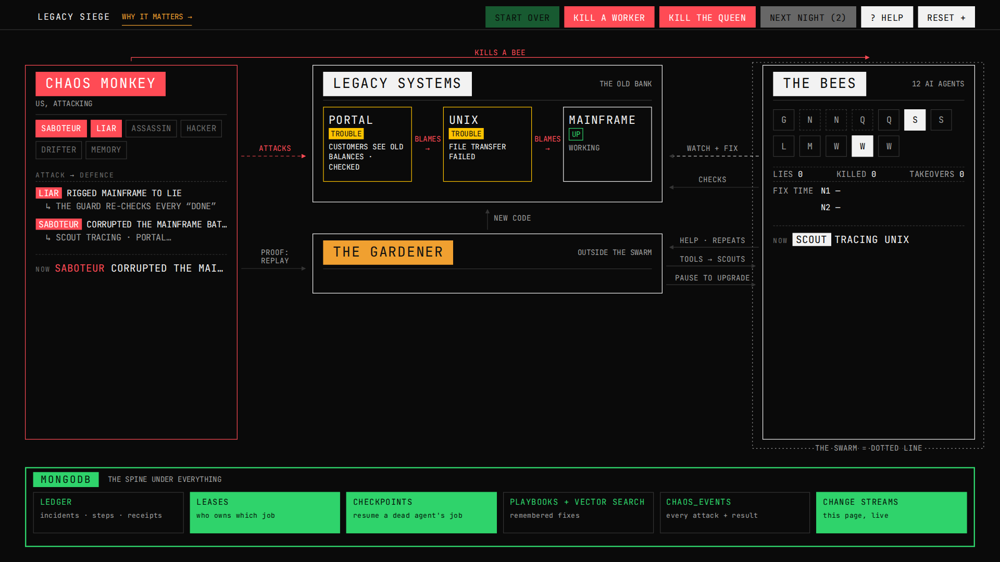
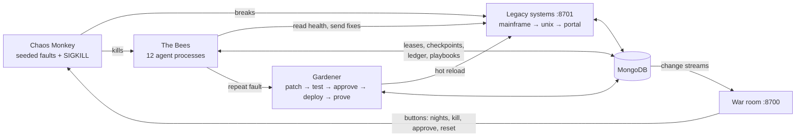

# Legacy Siege

A team of AI agents keeps a fake bank's legacy systems running while a chaos monkey attacks the systems and the agents.

<!-- SCREENSHOT: war room /diagram view mid Night 1: portal and unix degraded, bees walking the chain, activity stream visible.
     Save it as docs/screenshots/hero-diagram-night1.png, then uncomment the two lines below.

*Night 1 in the `/diagram` view. Everything on screen is read live from MongoDB.*
-->

## Highlights

- **Real processes, real crashes.** Every agent is its own OS process. The chaos monkey kills them with a real `SIGKILL`, and a standby agent picks up the work from its last MongoDB checkpoint.
- **Trust nothing the system says.** One agent, the Guard, reads the system's state back before any fix counts. It catches a system that answers "applied" when nothing changed.
- **Learns between nights.** A fixed incident becomes a playbook with a vector embedding. The next night, `$vectorSearch` recalls it and the agents skip most of the diagnosis.
- **Fixes the code, not just the outage.** When the same fault comes back on a second night, a separate Gardener process writes a small patch, tests it in a sandbox, asks a human to approve it, hot-reloads it, and replays the fault to prove the fix.
- **MongoDB holds all state.** Leases, checkpoints, the action ledger and memory all live in MongoDB, so any process can die and restart. The war room only watches change streams.
- **Runs with no API keys.** By default a deterministic policy picks every fix. Claude is optional: it can narrate, give a second opinion, or propose a plan that must pass the same guardrails.

## Quick start

**You need:**

- Docker with Compose v2.24 or newer (MongoDB runs in the `mongodb/mongodb-atlas-local:8.0` image)
- Python 3.12, only if you run the app outside Docker
- Git

Plain MongoDB Community will not work. The app needs Atlas Vector Search, which comes with the Atlas Local image or a real Atlas cluster.

First get the code:

```bash
git clone https://github.com/KrishNalam/legacy-siege.git && cd legacy-siege
```

### Option A: everything in Docker

```bash
docker compose -f deploy/docker-compose.yml up --build
```

You should see the `mongo` service turn healthy, then the `app` log the four `started …` lines described below.

### Option B: app on your machine, MongoDB in Docker

```bash
docker run -d --name legacy-siege-mongo -p 27027:27017 mongodb/mongodb-atlas-local:8.0
python3.12 -m venv .venv && .venv/bin/pip install -r deploy/requirements.txt
cp .env.example .env
.venv/bin/python run.py --reset
```

The terminal prints `setup_db ok`, then one `started … pid=… (logs/<name>.log)` line each for `systems`, `warroom`, `swarm` and `gardener`.
The first start can take up to two minutes while the vector index builds.

**Then open <http://localhost:8700/diagram>.**
You should see four boxes: Chaos Monkey, Legacy Systems, The Bees and The Gardener. All three systems are green.
Press Ctrl-C to stop everything.

API keys are optional. See [`.env.example`](.env.example).

## Run the demo

The demo is three "nights" of the same attack. In the `/diagram` view:

1. Press **Start**. Night 1 begins. The mainframe will lie about one command, then a bad record crashes its nightly batch job.
2. Watch the failure spread: unix goes degraded, then the portal. One incident opens, and a Scout traces it from the portal through unix to the mainframe.
3. Press **Approve** when the Beekeeper dialog appears. Restarting the batch job is destructive, so a human must approve it.
4. Press **Kill a worker** while it is lit (a worker has just sent a command). A Nurse takes over the work from the dead worker's checkpoint.
5. When everything is green, press **Next night**. Night 2 has the same fault. The bees recall the playbook and skip most of the diagnosis.
6. The same fault on a second night triggers the Gardener. It plans and tests a patch, then asks you. Press **Approve** again.
7. Once the patch is proven, press **Next night** for Night 3. The same attack lands and no incident opens.

**Reset +** offers "Reset this night" (keeps what the bees learned) and "Full reset" (wipes everything, including memory, and undoes the Gardener's patch).

<!-- SCREENSHOT: Guard stamping "ACK ≠ APPLIED" on the mainframe step in Night 1 -->
<!-- SCREENSHOT: Nurse takeover right after "Kill a worker" (dead worker greyed out, nurse holding the ticket) -->
<!-- SCREENSHOT: Gardener approval dialog showing the diff and test results after Night 2 -->

## How it works



`run.py` starts four processes: the systems API, the war room, the swarm supervisor and the Gardener. It restarts any of them that crashes.
The supervisor starts one process per agent and replaces dead agents after 15 s.
Agents hold work through MongoDB leases with fencing tokens. A killed agent's work is released by the Undertaker and picked up by a Nurse.

### The agents

| Role | Count | What it does |
|---|---|---|
| Queen | 2 (one on standby) | Holds the goal, assigns incidents to Scouts, relays approvals to the human. |
| Scout | 2 | Owns one incident: recalls playbooks, walks the dependency chain, plans the fix, resolves it. |
| Worker | 3 (mainframe, unix, web) | Investigates one system and sends fix commands. |
| Guard | 1 | The only agent that can mark a step verified. It checks by reading state back. |
| Sentinel | 1 | Polls system health, opens incidents, and acts as the **Undertaker** (marks silent agents dead). Files upgrade requests for repeat faults. |
| Waggle | 1 | Turns state changes into short status messages. |
| Nurse | 2 (standby) | Takes over work whose owner died, from its MongoDB checkpoint. |

The **Gardener** is a separate process outside the swarm.
The **Beekeeper** is you: the human who approves risky steps and code upgrades.
Some optional switches add agents (see [docs/configuration.md](docs/configuration.md)).

### The legacy estate

Three simulated systems, each with its own log style:

- **mainframe**: a z/OS-style ledger with a nightly batch job. When the batch fails, its health still says `up`. The clue is only in its logs and metrics.
- **unix**: a file-transfer host. It goes `degraded` and blames the mainframe when no batch file arrives.
- **portal**: online banking. It goes `degraded` and blames unix, but keeps serving stale balances with HTTP 200.

## Configuration

Everything works with no `.env`. Copy [`.env.example`](.env.example) to `.env` to change things.

| Variable | Default | What it does |
|---|---|---|
| `MONGODB_URI` | `mongodb://localhost:27027/?directConnection=true` | MongoDB with Atlas Search (Atlas Local or Atlas). |
| `WORLD_DB` / `SWARM_DB` | `world` / `swarm` | Database for the estate and chaos / database for the agents. |
| `SYSTEMS_PORT` | `8701` | Port of the legacy systems API. |
| `WARROOM_PORT` | `8700` | Port of the war room. |
| `PACE` | `1.0` | Multiplies every deliberate "thinking" pause. `0` = as fast as possible. |
| `WARROOM_VIEW` | `classic` | What `/` serves: `classic`, `diagram` or `flow`. |
| `ANTHROPIC_API_KEY` | none | Turns on Claude narration and the optional AI switches. |
| `LLM_MODEL` | `claude-haiku-5-5` | Claude model used when a key is set. |
| `VOYAGE_API_KEY` | none | Use Voyage embeddings instead of the built-in local hash embedding. |
| `DEMO_AUTOPLAY` | off | Nights advance by themselves; every approval after the first is automatic. |

<details>
<summary>Optional modes (all off by default)</summary>

| Switch | What it adds |
|---|---|
| `AI_SECOND_OPINION=1` | Claude reviews each plan; a rules judge marks each proposed step accepted or overruled. Needs a key. |
| `AI_DRIVES=1` | Claude's plan runs if it passes every guardrail; otherwise the rules plan runs. Needs a key. |
| `RED_FLEET=1` | Five AI attacker processes on top of the seeded chaos. Refuses the default DB names unless `RED_FLEET_ALLOW_LIVE=1`. |
| `SWARM_DYNAMIC=1` | Scouts and workers are spawned on demand and retire when idle. |
| `MONGO_SPINE=1` | Schema validators, change-stream pre-images and a lease chain-of-custody log. |
| `SCHEMA_DRIFT_DEMO=1` | Night 3 also renames a field in the unix feed; the bees learn the mapping. |
| `WORKFLOW_DRIFT=1` | The mainframe starts requiring a new step before a restart; the bees learn it. |

The full list, with timing knobs, is in [docs/configuration.md](docs/configuration.md).

</details>

## Other pages and tools

- War room views: `/` (classic), `/diagram`, `/flow`, `/why` (explainer page).
- Health check: `GET http://localhost:8700/healthz`.
- Chaos from the command line: `.venv/bin/python -m chaos.cli list` (faults and scenarios), `.venv/bin/python -m chaos.cli run bank-night-1`, `.venv/bin/python -m chaos.cli kill worker`.
- Full rehearsal against a running stack: `.venv/bin/python -m scripts.demo_check`. Exit code 0 means every beat passed. It does a full reset at the start and the end.
- Check that a MongoDB cluster supports everything: `.venv/bin/python -m scripts.atlas_check`.
- Unit tests (local MongoDB only, never Atlas):

  ```bash
  MONGODB_URI='mongodb://localhost:27027/?directConnection=true' PACE=0 .venv/bin/python -m pytest -q systems/tests
  ```

  The `gardener` and `swarm` tests also need Atlas Search, so run them against Atlas Local.

## Project layout

| Path | What is there |
|---|---|
| `run.py` | Starts and restarts the whole stack. |
| `systems/` | The three mock legacy systems (FastAPI, port 8701). |
| `swarm/` | The agents (LangGraph graphs, leases, recall, policy). |
| `chaos/` | Fault library, seeded scenarios, optional Red fleet. |
| `gardener/` | The patch pipeline and its one vetted remediation. |
| `warroom/` | The live web UI (FastAPI + plain JavaScript, port 8700). |
| `common/` | Config, MongoDB access, embeddings, optional LLM. |
| `scripts/` | Database setup, rehearsal and recording tools. |
| `deploy/` | Dockerfile, Compose files, Fly.io config, pinned requirements. |

Interfaces between parts are in [CONTRACTS.md](CONTRACTS.md). Team notes are in [docs/HANDOFF.md](docs/HANDOFF.md).

## Context and limitations

Built for a MongoDB hackathon in November 2026. It is a demo, not a product.

- **Needs Atlas Search.** Plain MongoDB fails at setup.
- **One machine.** The chaos monkey kills agents by PID, so all processes must share one host (or one container). Fly.io must stay at one machine.
- **One remediation.** The Gardener ships a single predetermined patch (batch record validation on the mainframe). Claude may explain it but never writes it.
- **No login.** The war room's buttons (reset, kill, approve) are open to anyone who can reach port 8700.
- **The Gardener edits `systems/mainframe.py` in place.** Use Full reset in the war room to undo it; `run.py --reset` does not.

## Credits

Built by [KrishNalam](https://github.com/KrishNalam) and [mh-anwar](https://github.com/mh-anwar).
Uses MongoDB Atlas (Vector Search, change streams, transactions), FastAPI, LangGraph, and optionally Anthropic Claude and Voyage AI.

## License

There is no license file yet, so all rights are reserved by the authors. Open an issue if you would like to reuse the code.
