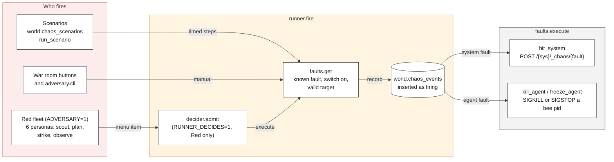

# Chaos

The Red side: seeded scenarios, manual buttons and an optional AI attacker fleet, all firing faults through one door, `runner.fire`.



## How it works

1. Every fault is a frozen `Fault` in `faults.FAULTS`. `faults.get` is the allow-list: it rejects unknown names and faults whose `switch` env var is off. `resolve_target` rejects targets the fault does not list.
2. `runner.fire` inserts the `world.chaos_events` document first (status `firing`), then runs `faults.execute` and writes the result back. The swarm never reads this collection.
3. System faults call the systems chaos hook (`hit_system`). Red never touches system state directly.
4. `agent_kill` reads the victim's pid from `swarm.agents` and sends a real `SIGKILL`. By default it waits for a worker in phase `step_sent`. `agent_freeze` sends `SIGSTOP`, then `SIGCONT`; `thaw.py` is a guardian that thaws even if the attacker dies.
5. Scenarios are fixed lists of `(t, fault, target, params)` with a seed, so a rehearsal replays the same timeline. `run_scenario` plays them in a daemon thread.
6. The Red fleet (`redfleet/`) runs one process per persona (`red-memory` only when `ADVERSARY_POISON_MEMORY` is on). Claude picks one item from the persona's menu; anything off the menu is rejected and the deterministic playbook decides. Params always come from the menu. The Gardener is never a kill target (`NEVER_KILL`).
7. The fleet refuses the live `world` / `swarm` databases unless `ADVERSARY_ALLOW_LIVE=1` (`core.live_db_refusal`).
8. `score.py` joins what Red fired with what the Hive did, by `run_id`, with one aggregation per database.

## Key files

| file | what's in it |
|---|---|
| `faults.py` | `Fault`, `FAULTS`, `get`, `resolve_target`, `execute`, `hit_system`, `kill_agent`, `freeze_agent`, `poison_memory`, `clear_all` |
| `runner.py` | `fire`, `start_run`, `run_scenario`, `cancel`, `wait`, `refresh_outcomes` |
| `scenarios.py` | seeded scenarios, `seed`, `get`, `list_all` |
| `cli.py` | `python -m adversary.cli list / run / fire / kill / clear / events / score` |
| `score.py` | `scorecard` (Red vs Blue per run) |
| `decider.py` | Runner decisions: `admit`, `Caps`, `record` |
| `decisions.py` | shared decision log: `log_decision`, `decisions` |
| `thaw.py` | thaw guardian for `agent_freeze` |
| `redfleet/personas.py` | the six personas (`PERSONAS`), their menus and `validate` |
| `redfleet/agent.py` | `Attacker`: one LangGraph loop per persona |
| `redfleet/core.py` | `Settings`, `live_db_refusal`, `scout`, `gate` |
| `redfleet/commander.py`, `redfleet/planner.py` | optional campaign planning on top of the strikers |
| `redfleet/__main__.py` | `run_fleet`, `run_agent` |

## Tests

```
MONGODB_URI='mongodb://localhost:27027/?directConnection=true' PACE=0 .venv/bin/python -m pytest -q adversary/tests
```

## Switches

| name | default | effect |
|---|---|---|
| `ADVERSARY` | off | Enables the fleet and the `false_log` / `credential_exploit` faults |
| `ADVERSARY_ALLOW_LIVE` | off | Lets the fleet attack the live `world` / `swarm` DBs |
| `ADVERSARY_LLM` | `1` | `0` makes personas use only their deterministic playbook |
| `ADVERSARY_MAX_ATTACKS` | `2` | Strikes per agent per night; `0` = unlimited |
| `ADVERSARY_COOLDOWN_S` | `30` | Pause between one agent's strikes |
| `ADVERSARY_AGENTS` | all | Comma list of attacker ids to run |
| `ADVERSARY_COMMANDER` / `ADVERSARY_PLANNER` | off | Campaign commander; planner in front of it |
| `RUNNER_DECIDES` | off | Runner admits, holds or denies every Red fire |
| `ADVERSARY_AGENT_FREEZE` | off | Enables `agent_freeze` |
| `ADVERSARY_AGENT_LIE` | off | Enables `lie_to_agent` |
| `ADVERSARY_POISON_MEMORY` | off | Enables `poison_memory` |
| `WORKFLOW_DRIFT` | off | Enables `workflow_drift` and adds it to scenarios |
| `SCHEMA_DRIFT_DEMO` | off | Adds a `schema_drift` step to scenarios |
| `ADVERSARY_OUTCOMES` | off | Watches each event's outcome in a background thread |

Back to the [main README](../README.md) · interfaces in [CONTRACTS.md](../CONTRACTS.md)
