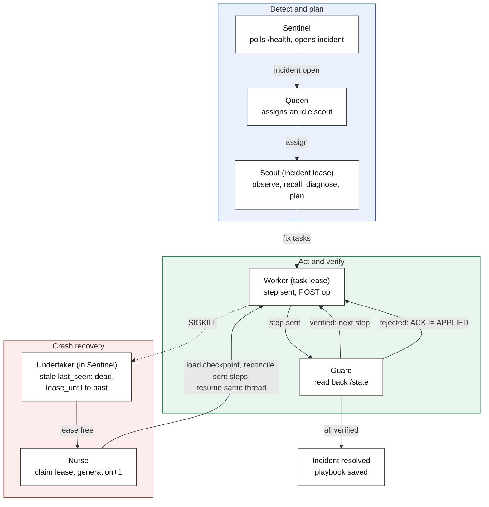

# Swarm

The Hive: a team of agent processes (queen, scout, worker, guard, nurse, sentinel, waggle) that detects, diagnoses and fixes incidents, with every bit of state in MongoDB.



## How it works

- `supervisor.py` starts one OS process per agent (`python -m agents.agent <role> <id>`). A SIGKILL is a real crash. After `RECOVERY_RESPAWN_S` the supervisor starts a fresh nurse in a dead bee's place; guard, sentinel, waggle, queen and nurse come back in their own role.
- Every agent runs on `harness.Agent`: it heartbeats `last_seen` in `swarm.agents` and renews its leases conditionally on `{owner, generation}`. A failed renew marks the lease lost and the code stops at its next `check()`.
- `leases.claim` is one `findOneAndUpdate` that bumps `generation` (the fencing token). `steps.py` writes each step change in one transaction: fence the task lease, update the incident step, upsert the ledger receipt. A replaced holder's write aborts.
- The Sentinel opens or coalesces an incident per unhealthy segment of the chain. The Queen hands it to a Scout. The Scout runs observe, recall (`$vectorSearch` playbooks), diagnose (one hop per run), classify, plan, dispatch.
- `policy.fix_plan` decides which ops run. The LLM never picks an op; it phrases thoughts, and with `AI_SECOND_OPINION` its proposal is judged against the deterministic plan.
- The Guard is the only agent that marks a step verified. It reads back `/state` (and a probe for security fixes) and checks `verify.check`. An ACK with unchanged state is rejected as "ACK != APPLIED". A slow op is re-checked until `SLOW_APPLY_S + 10` s.
- Nurse takeover is a LangGraph graph: `load_checkpoint`, `reconcile` (already applied: leave it to the Guard; not applied: resend with the same `action_id`), `record_handoff`. It then resumes the worker graph from the same thread (thread = task id).
- Waggle turns one change stream over incidents, agents and stats into short notes in `swarm.messages`.

## Key files

| file | what's in it |
|---|---|
| `supervisor.py` | `Supervisor`, `roster`, `ROSTER` / `DYNAMIC_ROSTER`, `SELF_RESPAWN` |
| `agent.py` | process entrypoint `main`, `warm` (pre-imported spare for dynamic scaling) |
| `harness.py` | `Agent` (heartbeat, lease renew, `think`), `checkpointer` (MongoDBSaver), `main_loop` |
| `leases.py` | `claim`, `takeover`, `renew`, `release`, `fence`, `LeaseLost`, `Fenced` |
| `steps.py` | `mark_sent`, `resubmit`, `take_over_sent`, `record_response`, `verify`, `reject` |
| `verify.py` | `check`: op postconditions by read-back |
| `policy.py` | `fix_plan`, `rebind`, `segments`, `downstream_order`, `exploit_signs` |
| `recall.py` | `search`, `evaluate`, `build_playbook` |
| `roles/sentinel.py` | detect, undertaker reap, upgrade requests (`build_graphs`, `run`) |
| `roles/scout.py` | incident graph (`build_graph`, `drive`, `claim_query`) |
| `roles/worker.py` | task graph (`build_graph`, `execute`, `reconcile_sent`, `ask_gardener`) |
| `roles/guard.py` | `read_back` then `judge` graph (`build_graph`, `run`) |
| `roles/nurse.py` | takeover graph (`build_graph`, `_orphans`, `run`) |
| `roles/queen.py`, `roles/waggle.py` | queen lease and triage; change-stream notes (`interpret`) |
| `lessons.py`, `recovery.py`, `schema.py`, `workflow.py`, `second_opinion.py` | switch-gated extras: failure memory, recovery rounds, schema drift, workflow drift, AI second opinion |

## Tests

```
MONGODB_URI='mongodb://localhost:27027/?directConnection=true' PACE=0 .venv/bin/python -m pytest -q agents/tests
```

## Switches

| name | default | effect |
|---|---|---|
| `AGENTS_ROSTER` | unset | `role:id,...` overrides the roster (tests) |
| `AGENTS_AUTOSCALE` | off | Scouts and workers spawned on request (`scale.py`) |
| `AGENTS_LEASE_DEADLINE` | off | Stop acting when a renewal is no longer locally fresh |
| `STEP_HOLD_S` | `pace(1.2)` | Pause between marking a step sent and POSTing it |
| `AGENTS_RECOVERY` | off | Re-diagnose and replan when an attack outlasts the attempt budget |
| `FAILURE_MEMORY` | off | Remember failed attempts as lessons |
| `WORKFLOW_DRIFT` | off | Adapt to a refused op that needs a new prerequisite step |
| `AI_SECOND_OPINION` | off | Claude proposes a plan; verification decides |
| `TOOLSMITH_ENGINEERS` | off | Adds `platform-1`, which builds vetted tools |
| `UPGRADER_HELP` | off | Adds `sentinel-2`; workers may ask the Gardener for advice |
| `HEARTBEAT_S` / `LEASE_S` / `RECOVERY_RESPAWN_S` | `3` / `10` / `15` | Timing from `common.config` |

More timing knobs (`MONITOR_POLL_S`, `VERIFIER_GRACE_S`, `MAX_ATTEMPTS`, ...) are in `settings.py`.

Back to the [main README](../README.md) · interfaces in [CONTRACTS.md](../CONTRACTS.md)
