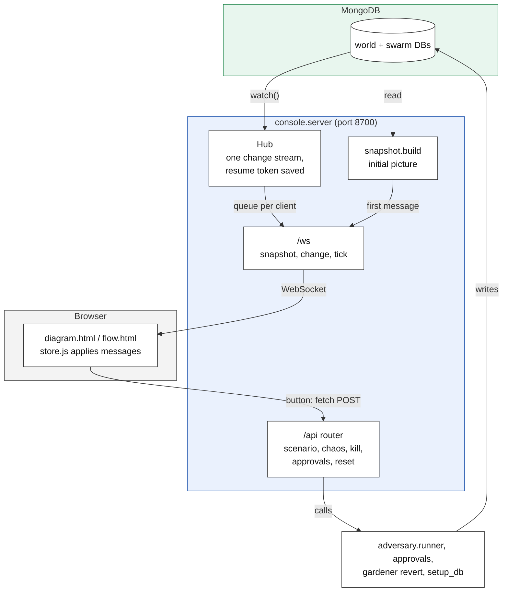

# War room

The live screen: a pure watcher of MongoDB that streams every change to the browser, plus a small REST API for the presenter's buttons.



## How it works

1. `Hub` opens one cluster-level change stream over both databases with `fullDocument: "updateLookup"`. It saves the resume token to `swarm.stats {_id: "stream_tokens"}`, so a restart misses nothing.
2. Heartbeat-only updates are counted, not forwarded. Bulky collections (`system_state`, `checkpoint_writes`) are counted only.
3. `/ws` subscribes to the hub first, then sends the snapshot from `snapshot.build`. Buffered changes replay after it; they are full documents, so applying one twice is safe.
4. The hub also sends a `tick` once a second with collection counts and events per second.
5. `bson_json` makes documents JSON-safe: datetimes to ISO, binaries to a size marker, embeddings to `{dims, model}`.
6. The buttons call `/api/...`. Approvals update only `{status: "pending"}` docs, so a decision lands once. `reset` with `mode: "full"` also reverts the Gardener's patch; `next_round` keeps playbooks.
7. With `DEMO_AUTOPLAY=1`, `autoplay.py` advances nights and auto-approves every approval after the first, using the same writes as the buttons.
8. `fake_feed.py` plays a scripted story into `world_dev` / `swarm_dev` so the page can be built without the rest of the stack.

## Key files

| file | what's in it |
|---|---|
| `server.py` | FastAPI app, `lifespan`, `ws`, `index`, `/diagram`, `/flow`, `/why`, `/healthz` |
| `stream.py` | `Hub` (`_watch_forever`, `broadcast`, `subscribe`, `_save_token`, `_tick_forever`), `change_pipeline`, `to_message` |
| `snapshot.py` | `build`: first picture for a new client |
| `api.py` | `start_scenario`, `fire_fault`, `kill_agent`, `decide`, `reset`, `scorecard`, `atlas`, `spine`, `roster`, `memory`, `get_doc` |
| `spine.py` | `analytics`: learning and custody aggregations |
| `autoplay.py` | `Autoplay`, `start_if_enabled` |
| `bson_json.py` | `to_json`, `slim` |
| `fake_feed.py` | scripted dev feed (`night1`, `night2`, `gardener`) |
| `static/js/store.js` | WebSocket client and `fetch` helper |
| `static/diagram.js`, `static/flow.js` | the two views and their buttons |

## Tests

```
MONGODB_URI='mongodb://localhost:27027/?directConnection=true' PACE=0 .venv/bin/python -m pytest -q console/tests
```

## Switches

| name | default | effect |
|---|---|---|
| `CONSOLE_VIEW` | `diagram` | Which page `/` serves (`diagram` or `flow`); `?view=` overrides |
| `DEMO_AUTOPLAY` | off | Advance nights and auto-approve (via `common.config`) |
| `AUTOPLAY_GAP_S` | `4` | Pause after a night goes green |
| `AUTOPLAY_APPROVE_S` | `3` | How long a later approval stays before auto-approve |
| `MONGO_SPINE` | off | Shows spine analytics (via `common.config`) |

Back to the [main README](../README.md) · interfaces in [CONTRACTS.md](../CONTRACTS.md)
