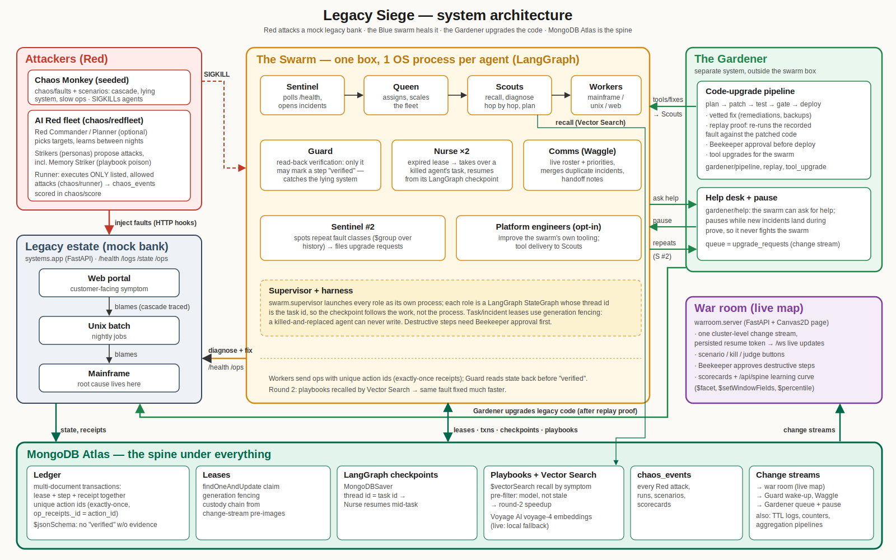
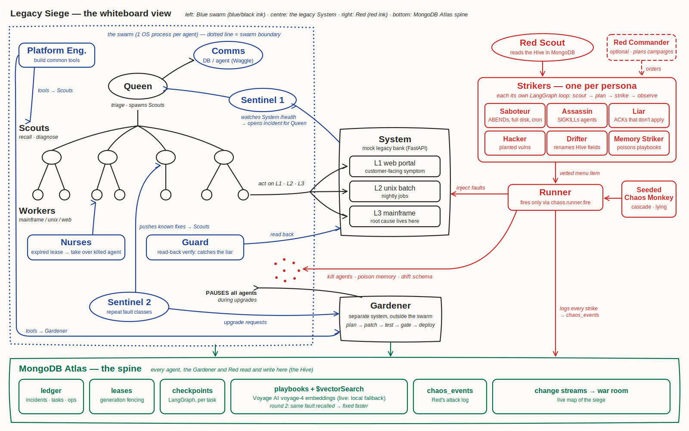
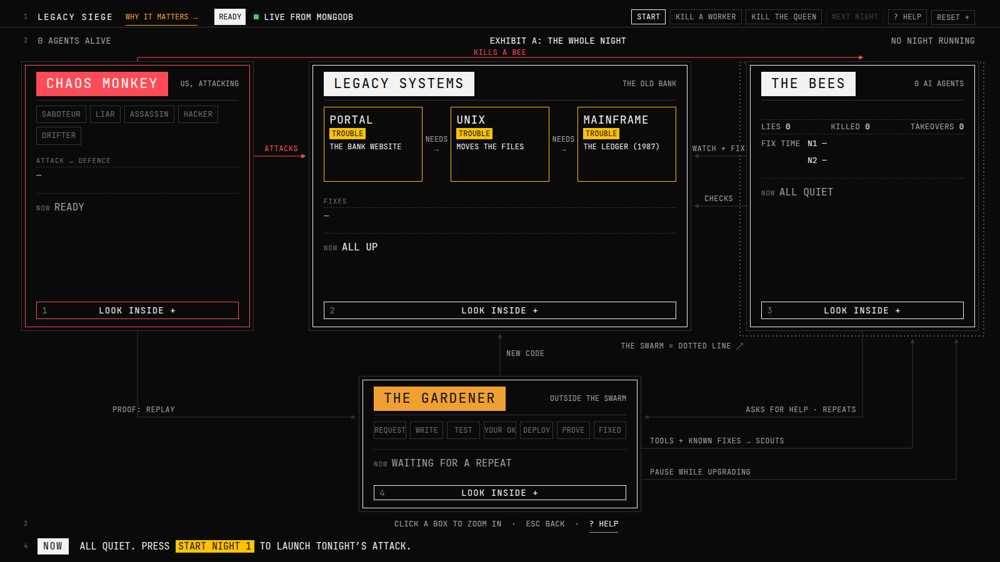

# Diagrams

All Legacy Siege diagrams in one place.

## Full-system architecture

The whole stack wired up: swarm, legacy estate, Red, Gardener and the MongoDB Atlas spine ([SVG](architecture.svg)).

## Whiteboard view

The team's whiteboard sketch made accurate: swarm tree with Guard, Nurses and Sentinels on the left, System L1/L2/L3 centre, Red Strikers (six personas, each a scout → plan → strike → observe loop, firing only via `chaos.runner.fire`) on the right, the Gardener outside the swarm pausing it during upgrades ([SVG](architecture-whiteboard.svg)).

## Gardener outside the swarm

The Gardener is a separate system: Sentinel 2 and Platform Eng. send it work across the swarm boundary, and it pauses all agents while it deploys.

## Mermaid version

[architecture-mermaid.md](architecture-mermaid.md): the same architecture as a Mermaid diagram that GitHub renders natively.
