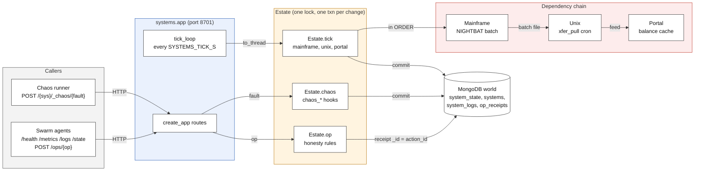

# Systems

The simulated legacy estate: a mainframe, a unix transfer box and a web portal, served by one FastAPI app with all state in MongoDB.



## How it works

1. `create_app` builds one `Estate` and starts `tick_loop`, which runs `Estate.tick` in a worker thread every `SYSTEMS_TICK_S` seconds. `SYSTEMS_TICK_S=0` turns the loop off. Tests then drive `POST /_admin/tick`.
2. Each system is a `LegacySystem` subclass. It only describes behaviour (`baseline`, `tick`, `health`, `state_view`, `op_*`, `chaos_*`). It never talks to MongoDB itself.
3. `Estate` loads a `Ctx` for one change inside a transaction. It commits the changed `system_state` kinds, the `world.systems` summary, new log lines and the op receipt together.
4. Ticks run in `ORDER` (mainframe, unix, portal), so downstream sees this tick's upstream state. A mainframe ABEND degrades unix, then the portal, which serves stale balances with HTTP 200.
5. Ops are exactly-once. `Estate.op` inserts the receipt with `_id = action_id`. A retry gets the stored receipt back, marked `duplicate`.
6. Honesty faults live in `Estate.op`. With `lying_success` armed, the op replies "OK - applied" and does nothing. With `slow_apply` armed, it replies "ACCEPTED - queued" and a later tick claims the receipt (`apply_at <= now`) and applies it. `false_log` only writes misleading log lines.
7. `Estate.clear_chaos` disarms the injectors and drops ops that have not landed yet. The damage already done stays. `Estate.reset` restores the baseline.
8. `POST /_admin/reload/{sys}` re-imports `systems/<sys>.py` and bumps the version. The Gardener uses it after patching `validate_record` in `mainframe.py`.

## Key files

| file | what's in it |
|---|---|
| `app.py` | FastAPI routes, `create_app`, `tick_loop`, exception handlers for `UnknownSystem` / `Resetting` |
| `estate.py` | `Estate`: `tick`, `_tick_one` (lands delayed ops), `op`, `_receipt_response`, `chaos`, `clear_chaos`, `reset`, `reload` |
| `base.py` | `LegacySystem`, `Ctx`, `Op`, `OpRefused`, `Vuln`, generic faults `chaos_lying_success`, `chaos_slow_apply`, `chaos_false_log` |
| `mainframe.py` | `Mainframe`: `run_batch`, `validate_record` (the weak spot), `op_quarantine_record`, `op_restart_batch`, `op_release_hold`, `chaos_batch_abort`, `chaos_workflow_drift`, `chaos_credential_exploit` |
| `unix.py` | `Unix`: `op_purge_spool`, `op_restart_cron`, `op_chmod_config`, `op_rerun_transfer`, `chaos_disk_fill`, `chaos_cron_stop`, `chaos_config_exploit`, `chaos_schema_drift` |
| `portal.py` | `Portal`: `feed_ok`, `op_flush_sessions`, `op_apply_patch`, `op_map_field`, `op_refresh_cache`, `chaos_session_leak`, `chaos_sqli_exploit` |

## Tests

```
MONGODB_URI='mongodb://localhost:27027/?directConnection=true' PACE=0 .venv/bin/python -m pytest -q systems/tests
```

## Switches

| name | default | effect |
|---|---|---|
| `SYSTEMS_TICK_S` | `1.0` | Seconds between ticks; `0` disables the background loop |
| `SYSTEMS_TICK_FIXED` | off | Tick on a fixed cadence (sleep minus tick time), for remote clusters |
| `BATCH_EVERY_TICKS` | `2` | How often the NIGHTBAT batch runs, in ticks |
| `CASCADE_TICKS` | `3` | How long a downstream system tolerates stale upstream data |
| `SLOW_APPLY_S` | `20` | Cap on the `slow_apply` delay (read via `common.config`) |
| `ADVERSARY_AGENT_LIE` | off | Allows the prompt-injection variant of `false_log` |

Back to the [main README](../README.md) · interfaces in [CONTRACTS.md](../CONTRACTS.md)
