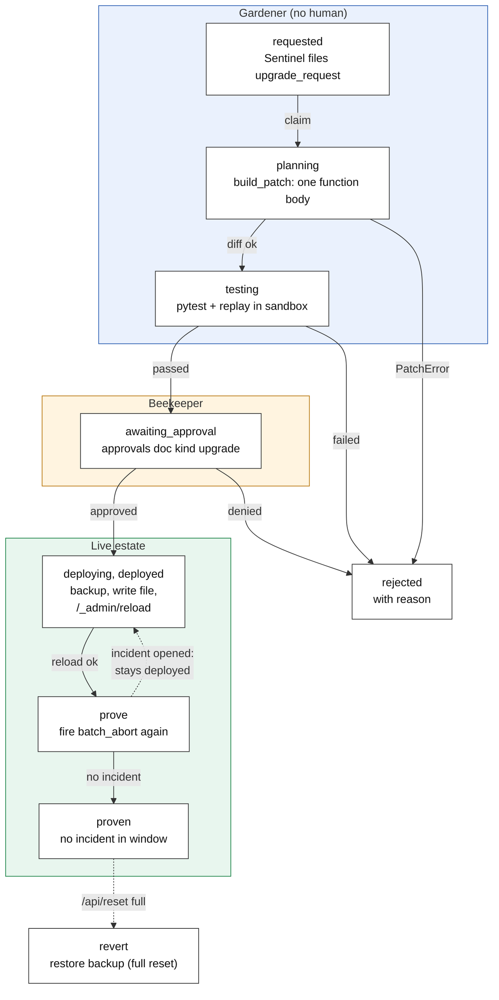

# Gardener

A separate process outside the swarm that turns a recurring incident into a reviewed, tested, approved and proven code upgrade of a legacy system.



## How it works

1. `main.serve` registers `gardener-1` in `swarm.agents`, resumes any upgrade it was in the middle of, then waits for `upgrade_requests` with status `requested` (change stream plus polling).
2. Every status change is a conditional `findOneAndUpdate` in `pipeline.advance`, so a step cannot run twice. A killed Gardener picks up from the stored status.
3. Plan: `build_patch` takes a predetermined remediation (`remediations/batch_validation.py`) and swaps one function body (`validate_record` in `systems/mainframe.py`) with `patcher.replace_body`. Every other byte stays. The LLM only writes the explanation.
4. Test: `testing.run_tests` copies `systems/` into a temp sandbox, writes the patch there, runs that system's pytest file and `replay.py` against `world_test_gardener`. Live files and the live DB are not touched.
5. Gate: `request_approval` creates the approval and flips the status in one transaction. `wait_for_decision` waits for the Beekeeper.
6. Deploy: re-derives the patch and refuses unless it equals what was approved, backs up the original into `backups/`, writes the file, calls `POST /_admin/reload/{sys}`. A failed reload restores the original.
7. Prove: fires the fault again and watches `incidents` for the window. No incident means `proven`. An incident leaves it `deployed`; there is no automatic revert.
8. `revert` only runs on a full reset. It restores the file only if it is byte-for-byte the Gardener's patch of a backup.

## Key files

| file | what's in it |
|---|---|
| `main.py` | process loop: `register`, `heartbeat`, `next_request`, `run_safely`, `serve` |
| `pipeline.py` | `plan`, `test`, `request_approval`, `wait_for_decision`, `gate`, `deploy`, `prove`, `run`, `requeue`, `revert`, `advance`, `build_patch` |
| `patcher.py` | `locate_function`, `replace_body`, `unified_diff`, `changed_outside`, `sha256` |
| `testing.py` | `make_sandbox`, `run_pytest`, `run_replay`, `run_tests`, `drop_replay_dbs` |
| `replay.py` | `unit_replay`, `app_replay`, `tool_replay` (runs as a subprocess in the sandbox) |
| `remediations/__init__.py` | `for_request`: registry of reviewed remediations |
| `remediations/batch_validation.py` | `detect_layout`, `render_body`, `sample_records` |
| `tools.py`, `tool_upgrade.py` | ship a vetted platform tool instead of a diff: `vet`, `receive`, `plan`, `test`, `deploy`, `prove` |
| `help.py` | help desk for workers and Sentinel #2: `ask`, `answer_help`, `answer_repeat`, `serve` |
| `backups/` | originals saved before each deploy (git-ignored) |

## Tests

```
MONGODB_URI='mongodb://localhost:27027/?directConnection=true' PACE=0 .venv/bin/python -m pytest -q upgrader/tests
```

## Switches

| name | default | effect |
|---|---|---|
| `PROVE_WINDOW_S` | `30` | How long prove watches for incidents (via `common.config`) |
| `GARDENER_PAUSE_MIN_S` | `4` | Minimum on-screen pause while the file is swapped |
| `GARDENER_REPLAY_WORLD_DB` | `world_test_gardener` | Sandbox world DB for the replay |
| `GARDENER_REPLAY_SWARM_DB` | `swarm_test_gardener` | Sandbox swarm DB for the replay |
| `GARDENER_SANDBOX_URI` | unset | Put the sandbox DB on a different MongoDB |
| `GARDENER_REPLAY_WAIT_S` | `6` | Replay wait time |
| `GARDENER_HELP` | off | Turns on the help desk |
| `GARDENER_HELP_WAIT_S` | `5` | How long a worker waits for an answer |
| `GARDENER_TOOL_PROVE_S` | `120` | Prove window for a tool upgrade |

Back to the [main README](../README.md) · interfaces in [CONTRACTS.md](../CONTRACTS.md)
